

  <a href="https://deskcast.app">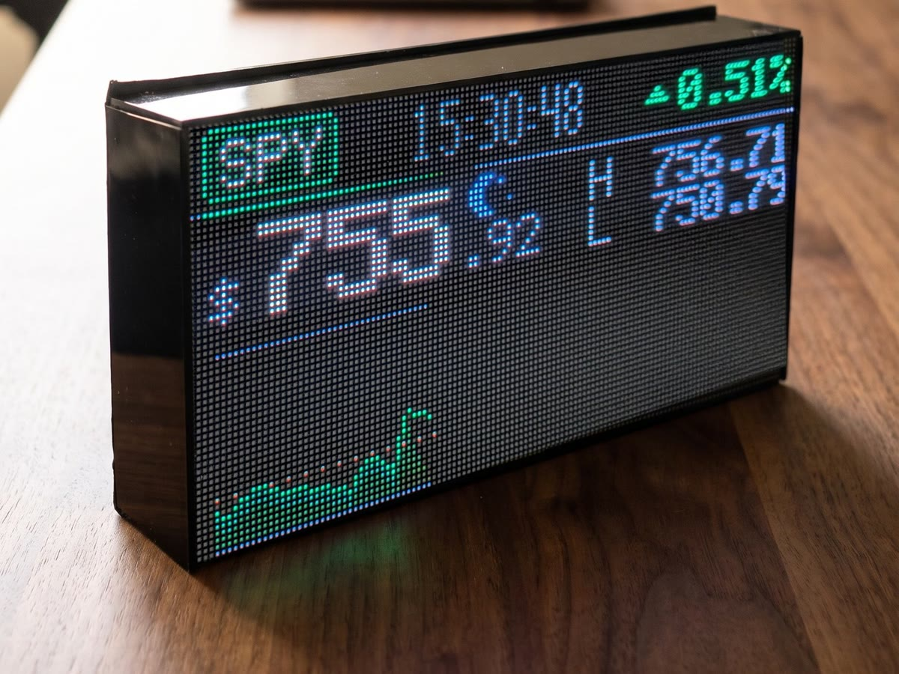</a>

<h1 align="center">Deskcast</h1>

  <b>The market, on your desk.</b> 
  A live LED display for your stocks, crypto and broker portfolio. 
  Check a price with a glance, not your phone.

  

  
  
  
  
  
  

---

## The screens

It rotates through the screens you turn on. Every one below is filmed on the
real prototype.

<table>
  <tr>
    <td width="50%" valign="top">
      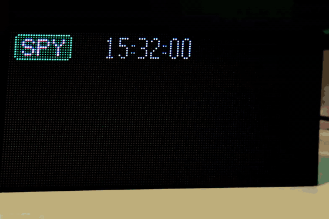 
      <b>📈 Live price</b> 
      Price, day move, high and low, the intraday chart and a countdown to the next bell.
    </td>
    <td width="50%" valign="top">
      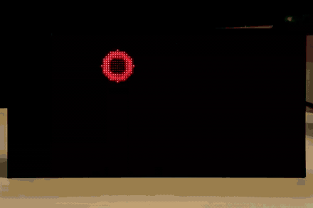 
      <b>🟩 Heat map</b> 
      Your watchlist as tiles that glow with the day's move.
    </td>
  </tr>
  <tr>
    <td width="50%" valign="top">
      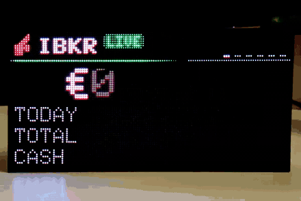 
      <b>💼 Your portfolio</b> 
      Your account's value, today's move and every position, page by page.
    </td>
    <td width="50%" valign="top">
      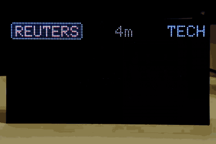 
      <b>📰 Headlines</b> 
      News about your symbols as cards. A chime when a new one lands, and the
      built-in speaker can read it out loud.
    </td>
  </tr>
  <tr>
    <td width="50%" valign="top">
      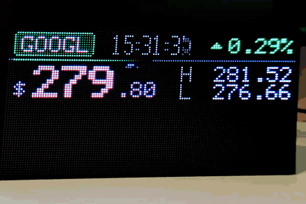 
      <b>🌅 Pre-market and after-hours</b> 
      From 4:00 New York time. A small sun before the open, a moon after the close.
    </td>
    <td width="50%" valign="top">
      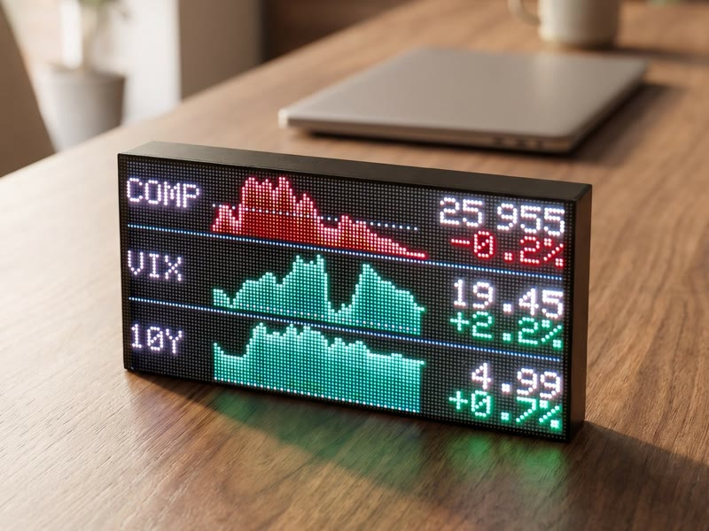 
      <b>🪙 Indices and crypto</b> 
      The Nasdaq, the VIX and yields side by side. Bitcoin, Ethereum or any coin, around the clock.
    </td>
  </tr>
</table>

## Your broker, on the panel

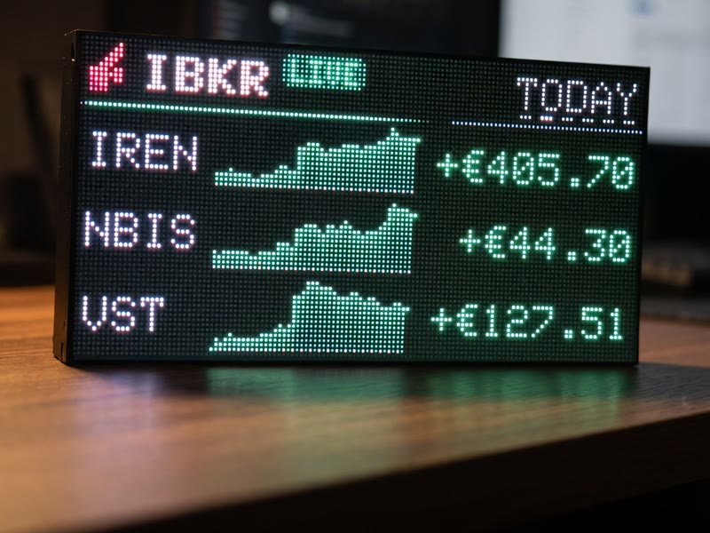

Connect **Trading 212**, **eToro** or **Interactive Brokers** with a read-only
key. Deskcast shows what your account is worth, how today went, and every
position with its weight and move.

- 🔒 **Read-only.** It can never place an order.
- 🗝️ Keys are stored encrypted and deleted when you disconnect.
- 🙈 Hide the amounts and show only percentages.

Missing a broker you use? Founding customers choose the next integration.

 

## Built to sit on your desk

  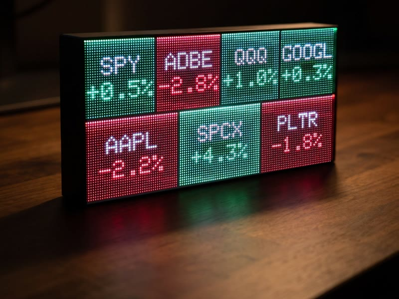
  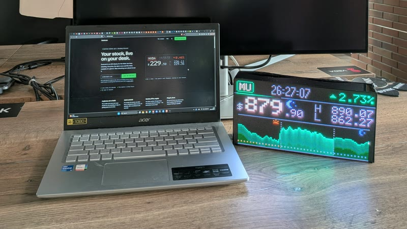

|  |  |
|---|---|
| **Display** | 128 × 64 RGB LEDs, 2 mm pitch |
| **Size** | 256 × 128 mm, readable from 40 cm to 4 m |
| **Brains** | ESP32-S3, 16 MB flash, 8 MB PSRAM |
| **Connectivity** | 2.4 GHz Wi-Fi, USB-C power |
| **Sound** | Speaker for headline chimes and read-aloud news |
| **Setup** | From your phone, over the panel's own Wi-Fi. No app to install. |
| **Refresh** | Every 15 seconds up to once an hour, your choice |
| **Updates** | Signed, over the air, with two firmware slots |

Designed and assembled by hand in Bulgaria. 🇧🇬

## It keeps itself up to date

This repo is where your Deskcast gets its updates. Each release ships two files
and nothing else:

| File | What it is |
|---|---|
| `esp32s3.ino.bin` | The firmware image for the ESP32-S3 inside the panel |
| `esp32s3.ino.bin.sig` | Its Ed25519 signature |

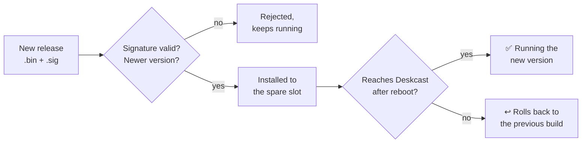

The device checks every download against the public key built into it, and
refuses anything that doesn't verify or is older than what it runs. You never
need to flash these by hand. The source code isn't public.

## Get one

The first 50 units are a founding batch, and those 50 never pay a subscription.
**[Join the waitlist on deskcast.app →](https://deskcast.app)**

- [Stock ticker display](https://deskcast.app/stock-ticker-display) ·
  [Crypto price display](https://deskcast.app/crypto-ticker-display) ·
  [Coming from a Tidbyt?](https://deskcast.app/tidbyt-alternative)
- [Setup and support](https://deskcast.app/support)
- Follow the build: [Instagram](https://www.instagram.com/deskcast.app) ·
  [TikTok](https://www.tiktok.com/@deskcast.app)

---

Every screen shown is the real prototype; some backgrounds are staged.
Deskcast only shows prices. It doesn't trade, market data may be delayed, and
nothing on it is investment advice. Ticker symbols belong to their respective
owners.
